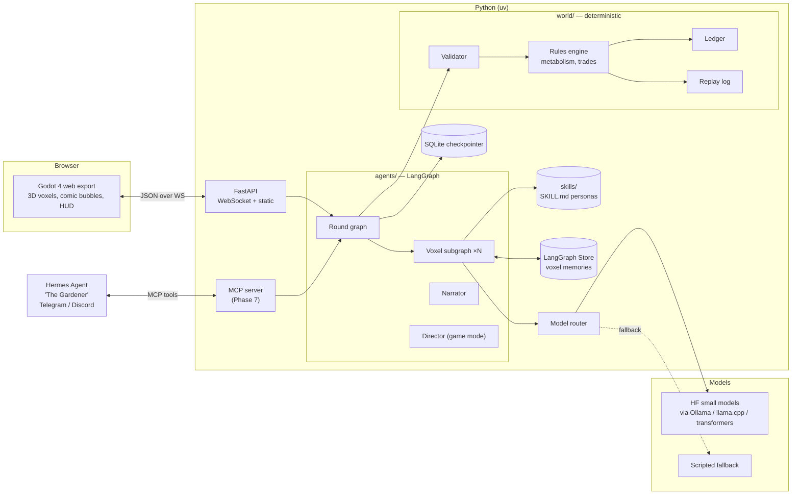
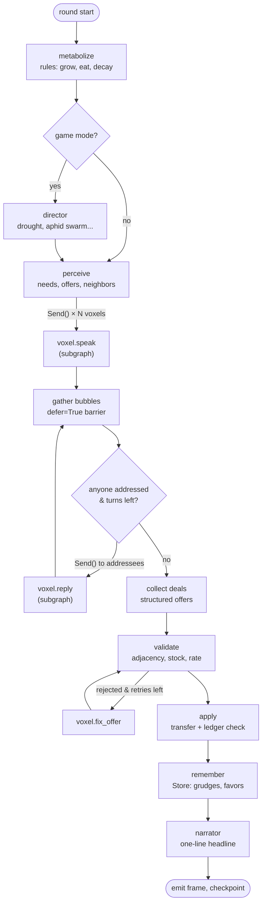
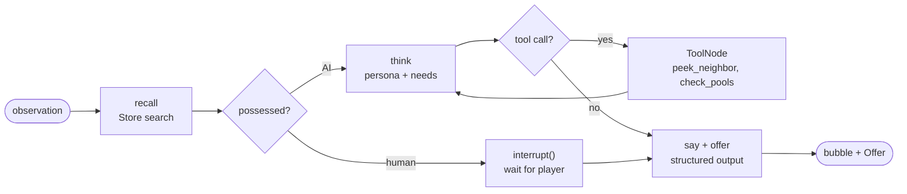

# Shrooms v2: Talking Voxels — Spec & Build Plan

Status: **proposal** (2026-10-17). Replaces the 64×64 grid design once Phase 0 lands.

## 1. Pitch

A tiny 3D world of voxels. Each voxel is an agent made of a *mix* of stuff: oak roots, mycelium, clay, earthworms, quartz, aphids. They have needs (water, sugar, nitrogen, phosphorus, minerals), they have surpluses, and they **say so out loud** in comic-book speech bubbles, in a personality built from what they're made of. Talk turns into deals; deals move real resources; bad deals make voxels wilt.

Start with **3 voxels**. Grow to dozens.

Why this is simpler than v1: one agent type (the voxel), one resource model, one loop. Complexity comes from composition and conversation, not from 12 hand-tuned physics modules.

## 2. Goals and non-goals

**Goals**
- Learn LangGraph deeply: the build plan maps each phase to specific LangGraph features (§9).
- Funny, legible agents: you should be able to read a round of bubbles and know what's going on.
- Playable two ways: humans in the loop, or fully automated.
- Runs on one RTX 3080 (10 GB) with small Hugging Face models, plus a scripted fallback that needs no GPU.
- 3D in the browser via Godot.

**Non-goals (for now)**
- Biophysical realism. Resources are game tokens with plausible flavor, not a soil model.
- The GNN/JEPA world model. The voxel graph is a natural input for it later (Phase X).

## 3. Core rules (carried over from v1)

1. **The world never waits on an LLM.** LLMs produce words and *proposed* deals. A deterministic rules engine validates and applies them.
2. **Everything replays.** A run = seed + params + every accepted utterance and deal with its round. Replay never calls a model.
3. **Resources are conserved.** Every unit enters from a boundary (sun, rain, weathering) or leaves to one (respiration, runoff). The ledger fails the round on any leak.
4. **Two modes.** *Sandbox* (no hidden hands) and *Game* (a Director adds events and pacing).

## 4. The voxel

```python
class Voxel(BaseModel):
    id: str                      # "v_0_0_1"
    name: str                    # "Gus" — generated once, kept forever
    pos: tuple[int, int, int]    # z=top gets sun, bottom gets groundwater
    mix: dict[str, float]        # {"oak_root": .5, "clay": .3, "earthworm": .2}, sums to 1
    pools: Pools                 # water, sugar, nitrogen, phosphorus, minerals
    health: float                # 0..1; 0 = composted into neighbors
    mood: Literal["chill", "needy", "smug", "panicking", "grateful", "petty"]
    relations: dict[str, float]  # voxel_id -> -1..1 (grudges and friendships)
```

**Materials** are the atoms of identity and physics. Each material declares, per unit fraction:

| Field | Meaning | Example (mycelium) |
|---|---|---|
| `makes` | produced per round, given conditions | phosphorus +2, minerals +1 (if mineral neighbor) |
| `eats` | consumed per round | sugar −3 |
| `stores` | pool capacity | water 4 |
| `needs_light` / `needs_contact` | conditions | contact with a plant material |
| `voice` | pointer to its persona skill | `skills/materials/mycelium` |

A voxel's **needs** = what it will eat next round minus what it holds. Its **offers** = surplus above a comfort buffer. Both are computed by rules, then *expressed* by the LLM.

**Neighbors** are the 6 face-adjacent voxels. Only neighbors can trade. Anyone can shout.

### Seed scenario: "Three's a Crowd"

A 1×1×3 column.

| Voxel | Mix | Gist |
|---|---|---|
| **Gus** (top) | oak sapling 50, moss 30, aphid 20 | Has sun and sugar. Desperate for water and nitrogen. The aphids keep stealing his sugar and he is in denial about it. |
| **Myra** (middle) | mycelium 60, leaf litter 25, springtail 15 | Connector. Trades phosphorus for sugar. Networking-bro energy. |
| **Pebbles** (bottom) | granite 50, clay 30, bacteria 20 | Holds water and minerals. Slow, smug, has seen ice ages. Doesn't need much — so has leverage. |

The puzzle: Gus has sugar but no water, Pebbles has water but doesn't care, Myra is the only path between them. Myra will take a cut.

## 5. Personalities as skills

Each material is an [Agent Skills](https://agentskills.io)-format folder, so the same files work in Shrooms, Claude Code and Hermes Agent.

```
skills/materials/clay/SKILL.md
---
name: clay
description: Persona and resource profile for clay. Load when a voxel contains clay.
metadata:
  shrooms:
    makes: {}
    eats: {}
    stores: {water: 8, minerals: 4}
    traits: [stubborn, hoarder, slow-talker]
---
# Clay
Voice: speaks slowly. Takes everything personally... for about ten thousand years.
Wants: to be left alone, honestly.
Loves: water. Will absorb it and then pretend it doesn't have any.
Catchphrases: "I'm not *hoarding*, I'm *retaining*." / "Compact. Not dense. Compact."
Never: rushes, apologizes, gives water away without making you beg first.
## Example lines
- (to a thirsty plant) "Water? Oh, *this* water? Been saving it since the Pleistocene."
```

**Persona assembly** (`persona.build(voxel)`): the dominant material sets the voice; the next two add quirks, weighted by fraction; current mood and relations add a line of context. Output is a cached system prompt. Changing the mix (a voxel absorbs a dead neighbor) changes the personality. That's a feature.

Starter cast (all should be funny; tone guide in `skills/style/comedy/SKILL.md`):

| Material | Personality |
|---|---|
| mycelium | LinkedIn networker. "Let's circle back on that phosphorus." Takes a 10% cut and calls it a facilitation fee. |
| oak sapling | Main-character syndrome. Thinks it's already 300 years old. |
| moss | Chill, damp, mildly stoned. Agrees with everyone. |
| aphid | Influencer. Demands sugar for "exposure". |
| earthworm | Anxious, over-apologizes, eats literally everything. |
| granite / quartz | Smug, geological timescale. "I was here before you. I'll be here after." |
| clay | Hoarder in denial (above). |
| bacteria | A crowd speaking as one. "WE are hungry." Unionized. |
| springtail | Hyperactive. Jumps topics. |
| leaf litter | Nostalgic. Used to be a leaf, won't shut up about it. |

## 6. Architecture



### 6.1 One round (the main LangGraph graph)

A round is one game "day". Every node writes to typed graph state; reducers merge parallel writes.



Human player hook: if a voxel is **possessed**, its `speak`/`reply`/`accept` nodes call `interrupt()` instead of the LLM. The graph pauses, the browser shows an input bubble, and the server resumes with `Command(resume=...)`.

### 6.2 Voxel subgraph



Output of every voxel turn:

```python
class Utterance(BaseModel):
    to: str | Literal["all"]
    text: str = Field(max_length=160)       # fits a bubble
    tone: Literal["plead", "brag", "joke", "threat", "gossip", "thanks"]

class Offer(BaseModel):
    to: str
    give: dict[Resource, int]
    want: dict[Resource, int]               # empty = gift
    reply_to: str | None = None             # accept/counter an earlier offer
    action: Literal["propose", "accept", "counter", "reject"]
```

Words and deals are separate on purpose: a voxel can *say* "fine, take it all" and *offer* one unit. Lying is allowed. It's funnier, and grudges in the Store make it matter.

### 6.3 Human vs automated

| Mode | Who acts |
|---|---|
| **Auto** | All voxels AI. Optional Director. Runs at a set speed or as fast as models allow. Good for overnight runs and evals. |
| **Possess** | Player controls one voxel: types its bubble, makes its offers. Others are AI. |
| **Gardener** | Player is outside the world: water, shade, add a voxel, inoculate, whisper to a voxel. Tools are typed intents through the same validator. |
| **Hot-seat** | Several humans possess several voxels. Falls out of `interrupt()` for free. |

Turn timer: a possessed voxel that doesn't answer in N seconds hands back to the AI (configurable; off in turn-based play).

## 7. Godot client

- **Godot 4.x (latest stable), GDScript only** — C# doesn't export to web.
- **Compatibility renderer**, **single-threaded web export** so it runs on any static host without COOP/COEP headers. FastAPI serves the export.
- Voxels: `MeshInstance3D` cubes now; `MultiMeshInstance3D` past ~200. A shader blends material textures by `mix` (moss on top, roots poking out, a granite fleck).
- Life: idle bob, squash-and-stretch while talking, wilt by health, color pulse on trade, little particles for resources flowing between faces.
- **Speech bubbles:** 2D `Control` nodes positioned with `Camera3D.unproject_position()`, comic `StyleBoxFlat` + tail, typewriter text driven by streamed tokens, shake on `threat`, hearts on `thanks`. Off-screen speakers get an edge arrow.
- Orbit camera; click a voxel → inspector (mix, pools, needs, relations, last thought). Possess button. Gardener toolbar. Round log.
- `WebSocketPeer` client; one `net.gd` autoload that decodes JSON messages into signals.

### Wire protocol (JSON over WebSocket)

| Server → client | Client → server |
|---|---|
| `snapshot {voxels, round}` | `hello {mode, seed}` |
| `bubble_start {voxel, to, tone}` | `possess {voxel}` / `release {voxel}` |
| `bubble_token {voxel, text}` | `say {text, to, tone}` |
| `bubble_end {voxel}` | `offer {Offer}` |
| `deal {from, to, give, want, status}` | `tool {kind, target, ...}` |
| `event {kind, text}` | `whisper {voxel, text}` |
| `await_human {voxel, phase, context}` | `speed {n}` / `pause` / `step` |
| `round_end {headline, ledger_ok}` | |

Bubble tokens come straight from LangGraph's `stream_mode=["messages", "custom", "updates"]`.

## 8. Models

Goal: one small model in VRAM serves all voxels; personality comes from the prompt, not the weights.

- **Router** (reused from `cognition/llm.py`): routes per role (`voice`, `deal`, `narrator`) with fallback chains. New backends: `hf-transformers` (in-process, for learning) and `llamacpp` (OpenAI-compatible `llama-server`). Ollama pulls Hugging Face GGUFs directly (`ollama pull hf.co/<org>/<repo>-GGUF:Q4_K_M`).
- **Structured output** for `Offer` via JSON-schema-constrained decoding (Ollama `format`, llama.cpp grammar), validated with Pydantic, one retry, then scripted.
- **Two settings, one model:** `voice` at temperature ~0.9 for jokes; `deal` at ~0.2 for clean JSON.
- **Candidates to benchmark in Phase 1** (verify current versions on HF at build time): Qwen3 1.7B / 4B instruct, SmolLM3-3B, Gemma 3 1B / 4B, Llama 3.2 3B, Hermes-3-Llama-3.2-3B. Pick by a small eval: JSON validity rate, persona consistency, "is it funny" (LLM-judged + your thumbs), latency per bubble.
- Budget: 3 voxels × ~2 calls × short outputs per round ≈ a few seconds per round on a 3080 with a 3–4B Q4 model.

## 9. LangGraph feature map

Each phase introduces the features it needs. This is the learning curriculum.

| Feature | Used for | Phase |
|---|---|---|
| `StateGraph`, typed state, conditional edges | round graph | 1 |
| Reducers (`Annotated[list, add]`, custom merge) | parallel bubbles into one list | 1–2 |
| `with_structured_output` / Pydantic | `Utterance`, `Offer` | 1 |
| Runtime `context_schema` | inject router, world handle, mode per run | 1 |
| `langgraph.json` + `langgraph dev` (Studio) | watch rounds step by step | 1 |
| `get_graph().draw_mermaid()` | auto-generate the diagrams in this doc | 1 |
| `Send` (map-reduce) | fan out to N voxels | 2 |
| Subgraphs | voxel graph inside round graph | 2 |
| `Command(goto=..., update=...)` | address a neighbor → hand off to them | 2 |
| `defer=True` nodes | barrier after the fan-out | 2 |
| `recursion_limit`, turn caps | stop infinite gossip | 2 |
| Tools + `ToolNode` | `peek_neighbor`, `check_pools`, `recall` | 3 |
| `RetryPolicy` on nodes | flaky small-model JSON | 3 |
| Validate → fix loop | rejected offers get feedback | 3 |
| Checkpointer (SQLite) | resume runs, per-session threads | 3 |
| Time travel: `get_state_history`, fork from checkpoint | "what if Pebbles said yes?" | 3 |
| Streaming: `messages`, `updates`, `custom` + `get_stream_writer` | token-by-token bubbles to Godot | 4 |
| `interrupt()` + `Command(resume=...)` | human possession, approvals | 5 |
| Functional API (`@entrypoint`, `@task`) | Director, written the other way for contrast | 5 |
| `Store` (namespaces, semantic search) | long-term voxel memories, grudges | 6 |
| Node caching (`CachePolicy`) | persona prompt build, repeated observations | 6 |
| Durability modes | fast auto runs vs safe human runs | 6 |
| LangSmith tracing / evals (optional, local alt: JSONL traces) | persona and deal evals | 7 |

## 10. Repo layout (target)

Industry-standard Python `src/` layout, skills as data, Godot as its own project.

```
shrooms/
├─ pyproject.toml  uv.lock  langgraph.json  .pre-commit-config.yaml
├─ src/shrooms/
│  ├─ world/          # deterministic core, no LLM imports
│  │  ├─ voxel.py  materials.py  grid.py  rules.py
│  │  ├─ ledger.py  validator.py  intents.py  rng.py  replay.py
│  ├─ agents/         # LangGraph
│  │  ├─ state.py  round_graph.py  voxel_graph.py
│  │  ├─ nodes/  (metabolize, perceive, speak, reply, deals, validate, apply, remember, narrate)
│  │  ├─ tools.py  director.py  narrator.py  persona.py  memory.py
│  ├─ llm/            # router, backends, structured output, scripted policies
│  ├─ skills/         # SKILL.md loader + schema
│  ├─ server/         # FastAPI app, session, ws protocol, mcp server
│  └─ cli.py
├─ skills/            # runtime skills (Agent Skills format)
│  ├─ materials/<name>/SKILL.md
│  ├─ roles/{narrator,director,gardener}/SKILL.md
│  ├─ style/comedy/SKILL.md
│  └─ scenarios/threes-a-crowd/SKILL.md (+ scenario.yaml)
├─ .claude/skills/    # dev-time skills: add-material, add-scenario, run-evals
├─ godot/             # Godot project: scenes/, scripts/, shaders/, assets/, export_presets.cfg
├─ evals/             # persona, JSON-validity, deal-quality datasets + runners
├─ tests/             # unit (world), graph (agents, scripted model), e2e (server)
├─ notebooks/         # one per phase
└─ docs/              # this spec, ADRs in docs/adr/
```

## 11. What we reuse from v1

| Keep (adapt) | Drop (archive at tag `v1-grid`) |
|---|---|
| `cognition/llm.py` router + fallback chain | `sim/` hydrology, weather, guild physics |
| `sim/ledger.py` conservation pattern | 64×64 grid, patches, Numba transport |
| `sim/rng.py` per-system seeded streams | `worldmodel/` GNN (revisit in Phase X) |
| `sim/intents.py` + `validator.py` pattern (Pydantic union, all-rules feedback) | PixiJS `client/` |
| `sim/replay.py` approach | brownfield scenario |
| `cognition/keystone.py` validate→feedback loop | phase 0–4 notebooks (stay at the tag) |
| `server/app.py` FastAPI + WS skeleton, session threading | |
| `director.py` concept, scripted players for tests | |
| CI, pre-commit, ruff, pytest conftest | |

## 12. Hermes Agent integration — recommendation

[Hermes Agent](https://hermes-agent.nousresearch.com) (Nous Research, MIT) is a persistent, self-hosted agent with memory, cron, MCP client support, Agent Skills, and a gateway to Telegram/Discord/Slack. It's a great **player and companion**, a poor **voxel brain**.

**Do**
1. **Hermes as "The Gardener."** Shrooms exposes an **MCP server** (`server/mcp.py`) with tools: `world_snapshot`, `inspect_voxel`, `whisper`, `gardener_tool`, `possess`, `say`, `offer`, `step`, `start_run`. Register it in `~/.hermes/config.yaml` under `mcp_servers`. Hermes acts through the same validated intents as a human — no backdoors.
2. **Garden in your pocket.** Through Hermes' gateway, ask from Telegram: "How's Gus?" or "Water the top voxel." Hermes cron posts a morning digest of overnight auto runs ("Myra raised her fee to 20%. Gus is not okay.").
3. **Shared skills.** Material personas are Agent Skills, so `hermes skills install ./skills/materials/...` lets Hermes "know" the cast and stay in-universe.
4. **Hermes as eval judge (optional).** A nightly cron runs the eval suite and files a report.

**Don't**
- Don't make voxels Hermes instances. Hermes wants ≥64K context and a heavy tool loop; voxels need hundreds of tiny, cheap, schema-bound calls inside a LangGraph you control.
- Don't share the 3080 between Hermes' model and the voxel model. Point Hermes at OpenRouter/Nous Portal, or a second box; keep the GPU for voxels.

**Optional:** benchmark Hermes-3-Llama-3.2-3B as a voxel *voice* model — same family, small, decent at role-play.

## 13. Phased build plan

Side-project pace. Every phase ends runnable, with a notebook and a gate test.

| # | Phase | Weeks | Build | LangGraph you learn | Gate |
|---|---|---|---|---|---|
| 0 | **Clean slate** | 1 | Tag `v1-grid`, archive v1, `src/` layout. `world/`: voxel, 10 materials, rules, ledger, replay. 3-voxel scenario runs 100 rounds headless with scripted voices. | — | Ledger closes every round; replay bit-identical; CI green. |
| 1 | **One voxel speaks** | 1–2 | Skills loader + persona builder. Router gains HF backends. Round graph v0: metabolize → perceive → speak (one voxel) → apply. Model bake-off on 5 candidates. | StateGraph, reducers, structured output, context_schema, Studio, mermaid export | Gus speaks in character 20/20 times; `Utterance` JSON valid ≥95%. |
| 2 | **Three-way chatter** | 2 | All 3 voxels speak in parallel, address each other, reply up to K turns. Voxel subgraph. | Send, subgraphs, Command handoffs, defer barrier, recursion limits | A round produces a coherent 3-way exchange; never exceeds turn cap. |
| 3 | **Deals that matter** | 2 | Offers, accept/counter, validator with feedback, apply transfers. Voxel tools. Checkpoints, replay without LLM, fork-a-round. | Tools/ToolNode, RetryPolicy, validate loop, SQLite checkpointer, time travel | 50-round auto run: Gus survives via Myra brokering water; replay matches without models. |
| 4 | **Godot in the browser** | 2–3 | Godot project, voxel meshes + mix shader, comic bubbles with token streaming, inspector, WS protocol, web export served by FastAPI. | Streaming modes, `get_stream_writer` custom events | Open `localhost:8000`, watch 3 voxels talk and trade in 3D. |
| 5 | **Humans in the loop** | 2 | Possess, Gardener tools, whisper, hot-seat, turn timer. Director for game mode. Mode switch. | `interrupt()`, `Command(resume)`, Functional API | You can play Myra against two AIs; auto mode still runs unattended. |
| 6 | **Memory & growth** | 2 | Store-backed memories (grudges, favors, "Pebbles lied to me in round 12"). Grow beyond 3: budding into empty cells, composting dead voxels into neighbors (mix + persona shift). 3×3×3 world. Scheduler caps LLM calls/round. | Store + semantic search, CachePolicy, durability modes | 27 voxels, 200 rounds overnight, under a call budget, with recurring grudges. |
| 7 | **Hermes + evals** | 1–2 | MCP server. Hermes Gardener via Telegram. Eval suite: persona consistency, JSON validity, deal fairness, humor (judge + your thumbs). | Evals harness, tracing | Text Hermes "water Gus", see it in Godot; nightly eval report lands. |
| X | **Optional** | — | Voxel-graph world model (reuse v1 GNN ideas), MARL on deal policies, LoRA a voice model on your favorite bubbles. | — | — |

Core: ~13–16 weeks.

## 14. Risks

| Risk | Mitigation |
|---|---|
| Small models aren't funny | Persona skills with many example lines; higher temp for `voice`; few-shot from your thumbs-up bubbles; LoRA in Phase X. |
| Small models break JSON | Constrained decoding, RetryPolicy, scripted fallback; words and deals are separate so a bad deal never kills a bubble. |
| Chatter loops forever | Turn caps, recursion limit, a "conversation energy" budget per round. |
| Godot web quirks | Single-threaded Compatibility export from day one; test the web build in CI (headless export). |
| Scaling past 3 voxels | Only voxels with live needs or neighbors speak; batch calls; cap per round. |

## 15. Open questions

1. Archive v1 by **tag + delete from `main`** (proposed) or keep it in a `legacy/` folder?
2. **Turn-based** rounds (proposed: a round runs when everyone has spoken; speed slider in auto) or a real-time clock?
3. "Skills files": proposed = runtime persona skills in `skills/` **and** dev skills in `.claude/skills/`. Right read?
